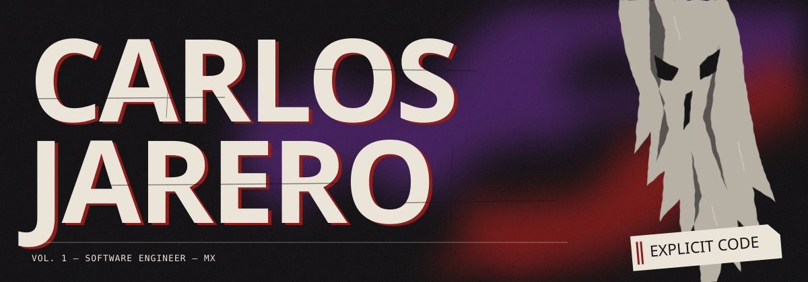

  

I'm Carlos Jarero, a Software Engineer with 5 years of experience.  
I work at Albo, a fintech in Mexico. I'm into AI and building things.  
I'm a Claude lover and a Codex fan.

## TRACKLIST

01. [taller-videos — 3:41](https://github.com/JustCarlos30/taller-videos)  
    A local short-video workshop with Remotion, Docker and Whisper voice. No API keys or paid services.
02. [skills-videos-cortos — 4:08](https://github.com/JustCarlos30/skills-videos-cortos)  
    Spanish skills for AI agents: script critique, Whisper voice, Remotion motion, sound, and a modular content creator.
03. [JustCarlos30 (Intro) — 1:12](https://github.com/JustCarlos30)  
    The profile. Start here.

## CREDITS

Day job: Albo — fintech  
Featuring: Claude, Codex  
Produced with: JavaScript, TypeScript, Python, Node.js, Docker, Remotion

More work to follow.
